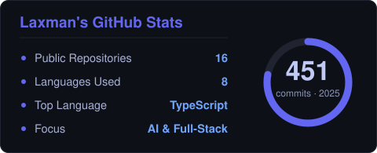
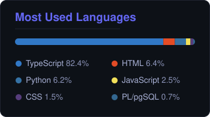

### 🚀 AI &amp; Full-Stack Developer — I build agentic, voice-first AI products that solve real problems

**2nd-year B.Tech CSE (AI &amp; ML)** @ **GCET**, Hyderabad &nbsp;·&nbsp; **IIT Madras** Foundation in Programming &amp; Data Science

---

## 👋 About Me

I'm **Laxman Sirvi** — a builder who ships. I'm a second-year **B.Tech student in Computer Science (AI &amp; ML)** at Geethanjali College of Engineering and Technology (CGPA 9.25), with the **Foundation level in Programming &amp; Data Science from IIT Madras** completed. I turn real-world problems into production software and deploy it for real users.

I don't stop at demos. I've shipped an **agentic AI job-search pipeline**, a full **AI career platform** (31 pages, 50+ API routes, 590+ tests), a **Spring Boot learning platform** with 800+ passing tests, and a **healthcare discovery app** with maps and an AI report explainer — end-to-end, from PostgreSQL row-level security and Next.js server components to LLM orchestration, provider failover, and cloud deployment on Vercel and Azure. I care about correctness, clean architecture, and software that actually works for its users.

- 🔭 **Currently building:** [Opportunity Radar](https://github.com/Laxmansirvi05/opportunity-radar) and its agentic search engine, plus [Campus Companion](https://github.com/Laxmansirvi05/student-management-system) and [CareRoute](https://github.com/Laxmansirvi05/Hospital_Managment_System).
- 🌱 **Sharpening:** Spring Boot &amp; testing, system design, and agentic AI workflows.
- 🎯 **Goal:** an internship in AI/ML, data science, or full-stack development — then top-tier engineering and higher study.
- 🌐 **Portfolio:** [laxmansirvi.me](https://laxmansirvi.me) — projects, tech stack, certificates, and how to reach me.
- ⚡ **Philosophy:** fewer, better-built things. Ship real, verify everything.

---

## 🚀 Featured Projects

### 🛰️ [Opportunity Radar](https://github.com/Laxmansirvi05/opportunity-radar) — AI career platform &nbsp;·&nbsp; [Live ↗](https://opportunity-radar-six.vercel.app)
A full-stack platform (31 pages, 50+ API routes) that helps students **discover, apply to, and prepare for** internships. Agentic AI search, a voice mock interviewer, a résumé toolkit, 20,000+ certifications, and an application tracker — all in one place. Row-level security on every table, 590+ tests passing.
 `Next.js 15` · `TypeScript` · `Supabase` · `PostgreSQL` · `Tailwind`

### 🎙️ [DeepInterview](https://github.com/Laxmansirvi05/Ai_voice_interview) — open-source contribution
I contribute to this open-source, voice-first mock interviewer. It runs a mock interview with an AI recruiter: live speech-to-text, streaming captions, a natural back-and-forth, then a **/100 score, model answers, and a saved report**. Built on LiveKit with Deepgram, Gemini, and self-hosted Kokoro TTS.
 `Python` · `LiveKit` · `Deepgram` · `Gemini` · `Real-time`

### 🤖 AI Job-Search Agent — agentic discovery pipeline &nbsp;(private · powers [Opportunity Radar](https://github.com/Laxmansirvi05/opportunity-radar))
An **agentic backend** that reads a résumé, plans a multi-source web search, extracts *real* postings (never listing pages), scores each against the candidate, and returns a ranked list — every result with a working apply link. Provider failover, quality gates, and a headless-browser fallback.
 `Node.js` · `n8n` · `LLM orchestration` · `Playwright` · `Tavily`

### 🎓 [Campus Companion](https://github.com/Laxmansirvi05/student-management-system) — learning platform &nbsp;·&nbsp; [Live ↗](https://campus-companion-go4c.onrender.com)
A Spring Boot student assistant and management system with 800+ passing tests.
 `Java` · `Spring Boot` · `Testing`

### 🧠 [ResumeAI](https://github.com/Laxmansirvi05/ResumeAI) — AI résumé builder
An AI-powered, ATS-friendly résumé generator with a clean, template-driven experience.
 `TypeScript` · `AI` · `Next.js`

### 💬 [Smart AI — SaaS Chat App](https://github.com/Laxmansirvi05/ai-saas-chat-app) — real-time AI chat
A modern SaaS chat application with real-time messaging, conversation history, and a responsive UI.
 `TypeScript` · `Next.js` · `AI`

---

## 🛠️ Tech Stack

**Languages**

**Concepts**

**Frameworks &amp; Libraries**

**Data &amp; Backend**

**Tools &amp; Platforms**

---

## 📊 GitHub Stats

---

## 📜 Certifications

- 🧠 Introduction to Generative AI — Google
- 🤖 Prompt Engineering with GitHub Copilot
- ☁️ AWS Foundations: Machine Learning Basics
- 📘 AI for Beginners
- 🗄️ SQL (Basic) — HackerRank
- 🗄️ SQL and Relational Databases 101 — IBM Skills Network
- ☕ Java Foundations — Oracle
- 📊 Data Analytics Job Simulation
- 🐍 Python Essentials 1
- ⚡ Claude Code in Action

---

## 🎓 Education

- **B.Tech, Computer Science &amp; Engineering (AI &amp; ML)** — Geethanjali College of Engineering and Technology (CGPA 9.25)
- **Foundation in Programming &amp; Data Science** — Indian Institute of Technology (IIT) Madras (completed)

---

## 🌐 Connect With Me

---

*“Fewer, better-built things. Ship real, verify everything.”*

⭐ From [Laxmansirvi05](https://github.com/Laxmansirvi05)

